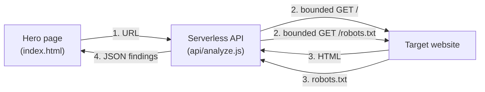

# AEO Readiness Check

A small introductory exercise for Freelopers: a hero page that submits a URL, an API that checks
the homepage and `robots.txt`, and findings rendered back on the page.

## Why it's not actually inside HubSpot

The plan was a HubSpot-hosted hero page. In practice, HubSpot's free tier has **no Custom HTML
module and no Embed module** — there's no way to run custom JS inside a page without a paid CMS
Hub plan. Per the brief's own allowance ("a partial/local demo is fine if integration blocks
you"), this ships as a standalone static page that *is* the intended hero — same markup, same
behavior — and would move into a real HubSpot custom module unchanged if a paid tier is available.

## Architecture



Request flow:
1. The browser submits a URL to `GET /api/analyze?url=...`.
2. The API validates the URL and rejects unsafe targets (see below).
3. It fetches the homepage and `robots.txt`, each bounded by a 5s timeout, a 500KB cap, and no
   redirects followed.
4. It runs 3 checks against that content and returns structured JSON.
5. The page renders each finding as a card: a status badge (`observed` / `unavailable` / `error`)
   plus evidence.

### The 3 checks (`api/checks.js`)

| Check | What it looks for | `observed` means | `unavailable` means |
|---|---|---|---|
| `title_h1` | `<title>` / first `<h1>` | found, shows the text | neither tag found |
| `json_ld` | every `<script type="application/ld+json">` tag, including types nested in `@graph` | at least one tag parses as valid JSON; reports tag count, how many parsed, and every `@type` found | no JSON-LD tag at all |
| `robots_txt` | `/robots.txt` | reachable; reports length, whether it has `Disallow` rules, and a snippet | not reachable (not treated as a failure — a missing `robots.txt` is normal) |

`error` (distinct from `unavailable`) means the fetch itself failed — DNS failure, timeout, or a
blocked redirect — not that the content was simply missing.

## How to run it

Requires Node 18+ (uses the built-in `fetch`).

```bash
node dev-server.js
```

Open **http://localhost:3000**. The URL field is prefilled with `https://www.freelopers.com/`;
click **Analyze**.

Run the test suite:

```bash
node api/checks.test.js
```

`dev-server.js` is a minimal local-only stand-in for `vercel dev` (there's no deployment set up);
the actual logic lives entirely in `api/analyze.js` and `api/checks.js`.

## What it allows

- Analyzing **any public http(s) URL**, not just Freelopers — the field is only *prefilled* with
  `www.freelopers.com`.
- Read-only `GET` requests to the homepage and `/robots.txt` of that URL. Nothing is written
  anywhere, and no HubSpot CRM/workflow is touched.

## What it does not allow

- **Private/internal targets are blocked before any fetch happens** (`isUnsafeTarget` in
  `api/checks.js`): `localhost`, loopback (`127.0.0.0/8`), private IPv4 ranges (`10.0.0.0/8`,
  `172.16.0.0/12`, `192.168.0.0/16`), the link-local/cloud-metadata range (`169.254.0.0/16`,
  which covers `169.254.169.254`), and the IPv6 equivalents. This is an SSRF guard — without it,
  an open "fetch any URL" endpoint can be used to probe a server's own internal network.
- **Non-http(s) schemes are rejected** (`javascript:`, `file:`, `ftp:`, etc.).
- **No redirects are followed**, anywhere, ever — a redirect (even a safe same-host one) comes
  back as `error: redirect_blocked` rather than being silently followed.
- **No LLM** — all 3 checks are plain HTML/JSON parsing.
- **No deployment** — runs locally only.

### Known limitation

`isUnsafeTarget` checks the literal hostname/IP in the submitted URL, but does **not** resolve
DNS first. A hostname that resolves to a private IP (DNS rebinding) would slip through.

## Examples to try

Paste these into the URL field:

| URL | What it demonstrates |
|---|---|
| `https://www.freelopers.com/` | Normal case — all 3 checks `observed` |
| `https://example.com/` | Missing data, not a failure — JSON-LD and robots.txt both `unavailable` |
| `https://freelopers.com` (no `www`) | Redirect blocked — the apex domain redirects to `www`, and all 3 checks come back `error: redirect_blocked` |
| `https://this-domain-does-not-exist-abc123xyz.com/` | Network failure — `error: fetch failed` (DNS resolution fails) |
| `http://localhost:3000/` | SSRF guard — rejected with `target_not_allowed` before any fetch |
| `http://169.254.169.254/` | SSRF guard — the cloud metadata address, also rejected |
| `not a url` | Rejected with `invalid_url` |
| `javascript:alert(1)` | Rejected with `invalid_url` (non-http scheme) |

## Project structure

```
index.html          hero page: URL field, Analyze button, loading/result/error states
api/analyze.js       serverless handler: validation, bounded fetch, response assembly
api/checks.js        the 3 checks + URL/target validation (pure functions)
api/checks.test.js   assert-based self-test for api/checks.js
dev-server.js        local-only dev server (stand-in for `vercel dev`)
```
